<div align="center">
  <a href="https://github.com/avdeshjadon/svgfetch-icons">
    <picture>
      <source media="(prefers-color-scheme: dark)" srcset="public/full_logo_dark.svg">
      <source media="(prefers-color-scheme: light)" srcset="public/full_logo.svg">
      
    </picture>
  </a>

  <p>
    <strong>Curated catalog of 1,960+ high-resolution, optimized SVG brand logos and icon marks.</strong>
    <br>
    Official asset registry for <a href="https://github.com/avdeshjadon/svgfetch">svgfetch</a> and modern web applications.
  </p>

  <p>
    <a href="#cdn-usage">CDN Usage</a> •
    <a href="#manifest-catalog">Manifest Catalog</a> •
    <a href="#variants">Variants</a> •
    <a href="#cli-integration">CLI Integration</a> •
    <a href="#license">License</a>
  </p>
</div>

---

## Overview

`svgfetch-icons` is a dedicated, zero-dependency CDN repository containing over **1,960+ vector assets** across **1,450+ global brands, tech companies, and open-source projects**.

Every vector file is cleanly formatted, scalable, and served globally through edge CDNs with zero bandwidth fees.

### Key Highlights
- **1,452 Curated Brands**: Google, Amazon, Apple, GitHub, React, Docker, Linux, and more.
- **Dedicated Icon Variants**: 460+ brands include both full wordmark (`<brand>.svg`) and standalone icon mark (`<brand>-icon.svg`).
- **CDN-Ready**: Instant global availability via jsDelivr, Statically, or direct raw delivery.
- **Searchable Index**: Complete metadata index available in [`manifest.json`](manifest.json).

---

## CDN Usage

All icons can be embedded directly in your HTML, React, Vue, Svelte, or web applications without installing any npm packages.

### jsDelivr CDN (Recommended)

```html
<!-- Full Logo / Wordmark -->


<!-- Standalone Icon Mark -->

```

### Statically CDN

```html

```

---

## Asset Variants

Whenever available, brands provide two standardized variants:

| Variant | Filename Convention | Description | Example |
| :--- | :--- | :--- | :--- |
| **Full Logo** | `<brand>.svg` | Complete logotype or wordmark | `logos/instagram.svg` |
| **Icon Mark** | `<brand>-icon.svg` | Standalone symbol / monogram | `logos/instagram-icon.svg` |

---

## Manifest Catalog

The complete catalog is structured in [`manifest.json`](manifest.json):

```json
[
  {
    "name": "Instagram",
    "shortname": "instagram",
    "url": "https://www.instagram.com/",
    "files": [
      "instagram-icon.svg",
      "instagram.svg"
    ]
  }
]
```

---

## CLI Integration

Search, inspect, and download any icon directly in your terminal using the official [svgfetch](https://github.com/avdeshjadon/svgfetch) CLI:

```bash
# Run instantly with npx
npx svgfetch instagram

# Or install globally
npm install -g svgfetch
svgfetch amazon
```

---

## Legal & Trademarks

All brand icons and logos included in this repository are trademarks of their respective owners. They are provided solely for editorial, identification, and development purposes.

This repository is licensed under the [MIT License](LICENSE).
